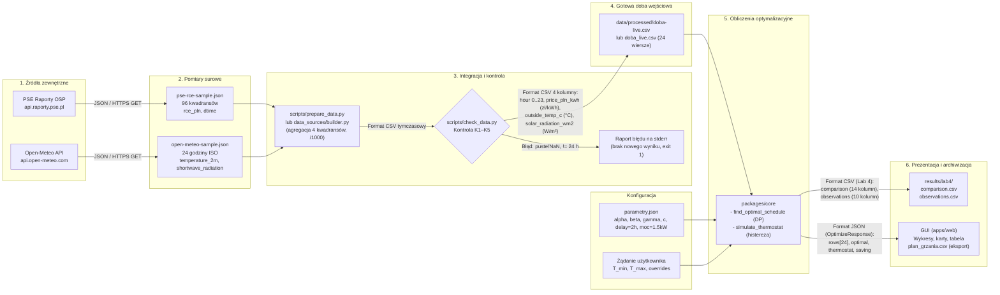
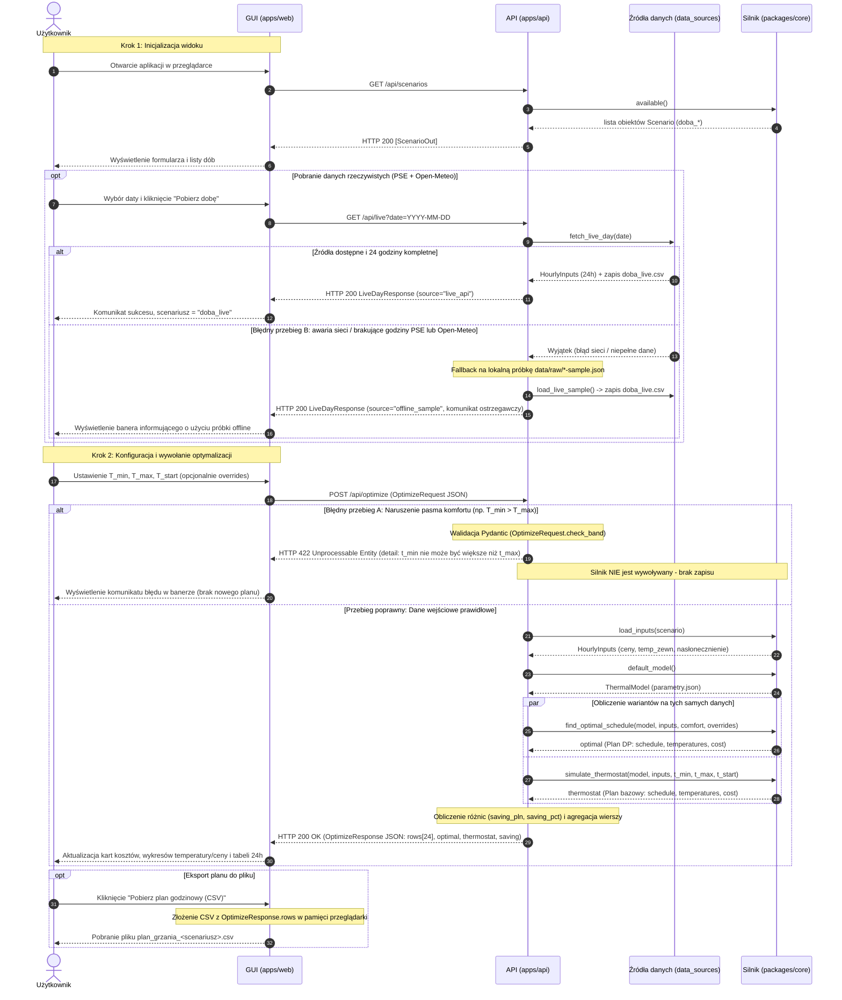

# Lab 5 — projekt architektury: optymalizator ogrzewania

Kolejność edycji tego pliku: Kacper → Karol → Patryk → Rączka → Oskar → Król.
Każda osoba przed edycją robi `git pull` i podmienia **tylko swój** blok `_(uzupełnia …)_`.
Każda osoba robi własny commit ze swoją sekcją.

| Osoba | Imię | Sekcja / rezultat | Diagram |
| ----- | ---- | ----------------- | ------- |
| 1 | Kacper Mazur | §1 granice systemu, odpowiedzialności modułów, §2 UC-01 | — |
| 2 | Karol Brzozowski | §3 kontrakt `POST /api/optimize` | — |
| 3 | Patryk Uchman | §4 model danych (schemat plików) | — |
| 4 | Sebastian Rączka | §5 przepływ danych, §6 diagram sekwencji UML UC-01, opcjonalnie diagram granic | Mermaid `flowchart LR` i `sequenceDiagram` (+ `examples/lab5/sequence.mmd`); opcjonalnie `docs/diagrams/granice.drawio` + PNG |
| 5 | Oskar Wysocki | ADR `docs/decisions/001-<temat>.md`, §7 co istnieje / co planowane | — |
| 6 | Sebastian Król | §8 przegląd + GitHub Issues | — |

Wariant architektury: **usługa z API** (FastAPI w `apps/api`) + **analiza plikowa**
(`scripts/`, `data/`, `results/`). Bez bazy danych — nie tworzymy fikcyjnej bazy pod diagram.

Wejście do projektu: `docs/problem.md` (wymagania R1–R6), `docs/data-dictionary.md`,
`docs/processing.md` (Lab 3), `docs/experiment.md` (Lab 4), `docs/PROJEKT.md` (warstwy).

Legenda statusu elementów: **istnieje** (jest w repo i działa) / **planowane** (do zrobienia, ma Issue).

---

## 1. Granice systemu

_Osoba 1 — Kacper Mazur._

**Użytkownik:** właściciel lub najemca domu z ogrzewaniem elektrycznym (grzałka 1,5 kW)
i taryfą dynamiczną. Jedna osoba, lokalnie, w przeglądarce. Bez kont i logowania —
wymagania R1–R6 tego nie uzasadniają.

**Systemy zewnętrzne** (poza naszą kontrolą, tylko odczyt):

| System | Co bierzemy | Format wejścia | Jak trafia do nas |
| ------ | ----------- | -------------- | ----------------- |
| PSE — raporty OSP, RCE (`api.raporty.pse.pl/api/rce-pln`) | ceny energii dla doby | JSON, 96 kwadransów, `rce_pln` w zł/MWh, `dtime` = koniec kwadransa | średnia z 4 kwadransów → `price_pln_kwh` w zł/kWh (`data_sources/pse.py`) |
| Open-Meteo (`api.open-meteo.com/v1/forecast`, `archive-api.open-meteo.com/v1/archive`) | pogoda dla Warszawy (52,23 N; 21,01 E) | JSON, 24 godziny, `temperature_2m` w °C, `shortwave_radiation` w W/m² | `outside_temp_c`, `solar_radiation_wm2` (`data_sources/open_meteo.py`); dziś i przyszłość → forecast, przeszłość → archive |

Oba źródła są publiczne, bez klucza i opłat. Gdy nie odpowiadają, system korzysta z próbki
`data/raw/*-sample.json` (doba 2026-10-13) i mówi o tym w komunikacie (`GET /api/live`, pole `source`).

**Zakres naszego rozwiązania:**

- złożenie doby wejściowej (24 h: cena, temperatura zewnętrzna, nasłonecznienie) z PSE i Open-Meteo
  albo z wbudowanego scenariusza CSV,
- symulacja temperatury budynku referencyjnego (`parametry.json`),
- plan DP i plan termostatu na **tych samych** danych, koszt w zł, kWh, godziny poniżej `T_min`,
- pokazanie wyniku w GUI i eksport planu do CSV,
- dodatkowo: porównanie 4 metod (`/api/compare`), analiza wrażliwości (`/api/sensitivity`).

**Poza zakresem** (`docs/problem.md`): sterowanie piecem na żywo, automatyka domowa, wiele
budynków, prognozowanie cen energii (bierzemy opublikowane RCE), konta użytkowników.

Diagram granic i modułów (opcjonalny): `docs/diagrams/granice.drawio` / `granice.png` (Sebastian Rączka).

### 1.1. Odpowiedzialności modułów

_Osoba 1 — Kacper Mazur._

| Moduł | Ścieżka | Odpowiada za | Nie odpowiada za | Status |
| ----- | ------- | ------------ | ---------------- | ------ |
| GUI | `apps/web` | zebranie ustawień (scenariusz, `T_min`, `T_max`, `T_start`, wymuszenia, data live), pilnowanie `T_min ≤ T_max` w panelu, wywołanie API, pokazanie wyniku lub komunikatu błędu, eksport planu CSV (po stronie przeglądarki) | obliczeń, walidacji zakresów, pobierania danych zewnętrznych | istnieje |
| API | `apps/api` | walidacja żądania (typy, zakresy, pasmo, wymuszenia 0/1 — `schemas.py`), wczytanie scenariusza, wywołanie silnika, mapowanie błędów na kody HTTP 404/422/502 (`main.py`) | wzoru temperatury i algorytmu DP | istnieje |
| Silnik | `packages/core` | model cieplny (`model.py`), plan DP (`optimizer.py`), termostat (`simulation.py`), metryki planu (`plan.py`), wczytanie CSV (`inputs.py`), godziny wymuszeń 0..23 | HTTP, pobierania danych z sieci | istnieje |
| Źródła danych | `packages/core/.../data_sources/`, `scripts/prepare_data.py` | pobranie PSE i Open-Meteo, przesunięcie kwadransów PSE na początek okresu, agregacja do godzin, kontrola 24 godzin i wartości skończonych (`builder.py`), zapis `doba_live.csv` | decyzji o grzaniu | istnieje |
| Kontrola danych | `scripts/check_data.py` | sprawdzenie przetworzonej doby (Lab 3) przed użyciem w porównaniu | poprawiania danych — tylko odrzuca | istnieje |

Moduł odpowiedzialny za kontrolę **ciągłości doby** (24 kolejne godziny bez dziur):
przy danych live — `data_sources/builder.py`; przy CSV z dysku — `scripts/check_data.py`.
Samo `inputs.py` sprawdza tylko kolumny i równe długości list — patrz luka 2 w §2.4.

---

## 2. Przypadek użycia UC-01

_Osoba 1 — Kacper Mazur._

| Element | UC-01 — plan grzania na 24 h i porównanie z termostatem |
| ------- | ------------------------------------------------------- |
| Cel i wymaganie | Użytkownik chce wiedzieć, w których godzinach najbliższej doby grzać, żeby nie zmarznąć i zapłacić jak najmniej, oraz ile to daje względem zwykłego termostatu. R1 (plan 24 h), R2 (ceny zmieniają plan), R3 (pasmo komfortu), R4 (porównanie z termostatem), R6 (koszt w zł) |
| Wejście | doba: scenariusz CSV albo data dla danych live (PSE + Open-Meteo); `T_min`, `T_max` [°C], `T_start` [°C], opcjonalnie `max_overshoot` [°C] i wymuszenia godzin `{h: 0\|1}` |
| Warunek rozpoczęcia | doba ma 24 kolejne godziny z ceną, temperaturą zewnętrzną i nasłonecznieniem (skończone liczby, nasłonecznienie ≥ 0); `T_min ≤ T_max`; dostępny `parametry.json` |
| Przebieg | wybór doby i pasma w GUI → `POST /api/optimize` → walidacja żądania → wczytanie doby i modelu → plan DP + symulacja termostatu na tych samych danych → odpowiedź JSON → karty, wykresy, tabela godzinowa |
| Wynik | dwa harmonogramy 0/1 na 24 h z temperaturą w każdej godzinie; dla każdego: koszt [zł], energia [kWh], godziny poniżej `T_min` [h], deficyt [K·h]; oszczędność DP vs termostat [zł, %]; nazwa scenariusza i parametry, z którymi liczono |
| Brak danych / błąd | obliczenie przerwane, komunikat mówiący, czego brakuje (np. „Brakujące godziny dla ceny: [17]”, „t_min nie może być większe niż t_max”); **bez planu i bez kosztu 0 zł** |
| Kryterium odbioru | (1) dla `data/processed/doba-live.csv` (2026-10-13), `T_min` 21,0, `T_max` 22,5, start 21,8 wynik zgodny z Lab 4: termostat 11,15 zł / 4 h poniżej `T_min`, DP 5,35 zł / 0 h (`scripts/compare_methods.py` + `scripts/check_lab4.py`); (2) `T_min > T_max` → HTTP 422 i brak nowego planu; (3) doba bez jednej godziny → błąd, a nie plan na 23 h |

### 2.1. Poprawny przebieg

1. Użytkownik otwiera GUI. GUI pobiera listę dób (`GET /api/scenarios`).
2. Użytkownik wybiera dobę: gotowy scenariusz **albo** datę w karcie „Dane publiczne” →
   `GET /api/live?date=…` → źródła danych składają 24 h z PSE i Open-Meteo i zapisują `doba_live.csv`.
3. Użytkownik ustawia `T_min`, `T_max`, `T_start` (i ewentualnie wymuszenia godzin).
4. GUI wysyła `POST /api/optimize` (kontrakt w §3).
5. API waliduje żądanie, wczytuje dobę i `parametry.json`.
6. Silnik liczy plan DP (najpierw kara za zimno, potem koszt) i plan termostatu — te same dane i model.
7. API zwraca 24 wiersze godzinowe i podsumowania obu planów.
8. GUI pokazuje oszczędność, koszty, wykres temperatury, wykres ceny z godzinami grzania i tabelę;
   użytkownik może pobrać plan jako CSV.

### 2.2. Błędny przebieg A — niepoprawne ustawienia

1–4. Jak wyżej, ale żądanie ma `T_min > T_max` (np. wysłane z pominięciem panelu) albo wartość poza zakresem.
5. API odrzuca żądanie przed obliczeniem: HTTP 422 z opisem w `detail`.
6. Silnik nie jest wywoływany, nic nie jest zapisywane.
7. GUI pokazuje komunikat w banerze.

### 2.3. Błędny przebieg B — niepełna doba z danych publicznych

1–2. Użytkownik wybiera datę, ale PSE albo Open-Meteo zwraca dane bez którejś godziny.
3. Parser przerywa składanie doby: `pse.py` — „Brak danych cenowych PSE dla godziny h”,
   `open_meteo.py` — „Oczekiwano dokładnie 24 unikalnych godzin…”, `builder.py` — „Brakujące godziny dla …”.
4. Niepełna doba **nie trafia** do `doba_live.csv` — zapis jest dopiero po złożeniu pełnych 24 h.
5. API przechodzi na plan awaryjny: `doba_live.csv` dostaje próbkę z `data/raw/` (2026-10-13),
   a pole `source` + komunikat mówią, z czego liczono. Gdy próbki też brak — HTTP 502 z opisem błędu.
6. Użytkownik widzi w karcie „Dane publiczne”, że wynik nie dotyczy wybranej daty.

### 2.4. Niespójności znalezione przy opisie UC-01 (do Issues w §8)

1. **Stary wynik przy błędzie.** Gdy `POST /api/optimize` zwróci błąd, `useOptimization.ts`
   zostawia poprzedni `result`, a `App.tsx` pokazuje go razem z banerem błędu. Użytkownik widzi plan
   policzony dla **innych** ustawień niż te w panelu. Kryterium: przy błędzie prawa kolumna nie
   pokazuje kosztu ani planu (albo wyraźnie oznacza go jako nieaktualny).
2. **Brak kontroli ciągłości przy wczytaniu CSV.** `HourlyInputs.from_csv` sprawdza kolumny,
   ale nie liczbę ani ciągłość godzin — plik z godzinami 0 i 5 daje plan na 2 h bez błędu
   (sprawdzone). Kontrola jest tylko w `scripts/check_data.py` i w `builder.py` dla danych live.
   Kryterium: scenariusz bez godziny 0..23 → HTTP 422, nie plan.

---

## 3. Kontrakt interfejsu `POST /api/optimize`

_Osoba 2 — Karol Brzozowski._

Granica: **GUI ↔ API** (HTTP/JSON). Jest to krok „obliczenie” w UC-01: jedno wywołanie zwraca
plan DP i plan termostatu na tych samych danych.

Źródło prawdy: `apps/api/src/hems_api/schemas.py` i `apps/web/src/api/types.ts` (muszą być zgodne).
Obsługa błędów: `apps/api/src/hems_api/main.py`. Testy: `apps/api/tests/test_api.py`.
Wszystkie odpowiedzi poniżej sprawdzone na działającym kodzie (`fastapi.testclient`, 2026-11-03).

### 3.1. Wejście

| Pole | Typ | Jednostka | Domyślnie | Ograniczenie |
| ---- | --- | --------- | --------- | ------------ |
| `scenario` | string | — | `doba_zmienna_cena` | nazwa z `GET /api/scenarios` (plik CSV doby) |
| `t_min` | float | °C | 21.0 | 5.0 ≤ x ≤ 30.0, `t_min ≤ t_max` |
| `t_max` | float | °C | 22.5 | 5.0 ≤ x ≤ 30.0 |
| `t_start` | float | °C | 21.8 | 0.0 ≤ x ≤ 35.0 — temperatura wewnątrz o godz. 0 |
| `max_overshoot` | float | °C | 1.0 | 0.0 ≤ x ≤ 5.0 — ile DP może przekroczyć `t_max` |
| `overrides` | obiekt `{godzina: 0\|1}` | h → stan | `{}` | godzina 0..23, stan 0 albo 1; dotyczy **tylko planu DP** |
| `model_params` | obiekt | — | `{}` | opcjonalna podmiana `alpha`, `beta`, `gamma`, `constant`, `delay` (0..6 h), `heater_power_kw` (> 0, kW); brak pola = wartość z `parametry.json` |

Wszystkie pola są opcjonalne — puste `{}` liczy domyślny scenariusz.

### 3.2. Wynik (HTTP 200)

| Pole | Typ | Jednostka | Znaczenie |
| ---- | --- | --------- | --------- |
| `scenario`, `t_min`, `t_max`, `t_start` | jak wejście | | echo parametrów, z którymi liczono |
| `hours` | int | h | długość doby (24) |
| `rows[]` | lista 24 obiektów | | jeden wiersz = jedna godzina |
| `rows[].hour` | int | h | 0..23 |
| `rows[].price_pln_kwh` | float | zł/kWh | cena RCE z pliku doby |
| `rows[].outside_temp_c` | float | °C | temperatura zewnętrzna |
| `rows[].solar_radiation_wm2` | float | W/m² | nasłonecznienie |
| `rows[].optimal_state` / `thermostat_state` | int 0\|1 | — | decyzja grzania DP / termostatu |
| `rows[].optimal_temp_c` / `thermostat_temp_c` | float | °C | temperatura wewnątrz |
| `rows[].optimal_cost_pln` / `thermostat_cost_pln` | float | zł | koszt w tej godzinie |
| `optimal`, `thermostat` | `PlanSummary` | | podsumowanie planu |
| `.cost_pln` | float | zł | koszt doby |
| `.energy_kwh` | float | kWh | zużyta energia |
| `.heating_hours` | int | h | liczba godzin grzania |
| `.hours_below_t_min` | int | h | godziny poniżej `t_min` |
| `.deficit_kh` | float | K·h | suma niedogrzania poniżej `t_min` |
| `.mean_temp_c` | float | °C | średnia temperatura wewnątrz |
| `saving_pln` | float | zł | `thermostat.cost_pln − optimal.cost_pln` |
| `saving_pct` | float | % | oszczędność względem termostatu; 0.0, gdy koszt termostatu = 0 |

Przykład żądania:

```json
{"scenario": "doba_szczyt_wieczorny", "t_min": 21.0, "t_max": 22.5, "t_start": 21.8}
```

Przykład odpowiedzi (skrócony — `rows` ma 24 elementy):

```json
{
  "scenario": "doba_szczyt_wieczorny", "hours": 24,
  "t_min": 21.0, "t_max": 22.5, "t_start": 21.8,
  "rows": [
    {"hour": 0, "price_pln_kwh": 0.5, "outside_temp_c": 1.0, "solar_radiation_wm2": 0.0,
     "optimal_state": 1, "optimal_temp_c": 21.64, "optimal_cost_pln": 0.75,
     "thermostat_state": 0, "thermostat_temp_c": 21.64, "thermostat_cost_pln": 0.0}
  ],
  "optimal":    {"cost_pln": 8.625,  "energy_kwh": 16.5, "heating_hours": 11, "hours_below_t_min": 0, "deficit_kh": 0.0,  "mean_temp_c": 21.87},
  "thermostat": {"cost_pln": 22.545, "energy_kwh": 24.0, "heating_hours": 16, "hours_below_t_min": 5, "deficit_kh": 0.92, "mean_temp_c": 21.65},
  "saving_pln": 13.92, "saving_pct": 61.74
}
```

### 3.3. Błędy

Błąd nigdy nie zwraca planu ani kosztu „0” — odpowiedź ma tylko pole `detail`.

| Sytuacja | Kod | Treść `detail` | Kto wykrywa |
| -------- | --- | -------------- | ----------- |
| Niepoprawny JSON (np. ucięty) | **422** | lista, `type: "json_invalid"` | FastAPI |
| Zły typ pola (np. `"t_min": "abc"`) | 422 | lista, `type: "float_parsing"`, `loc: ["body","t_min"]` | Pydantic |
| Wartość poza zakresem (np. `t_min: 40`) | 422 | lista, `type: "less_than_equal"` | Pydantic |
| `t_min > t_max` | 422 | lista, `msg: "Value error, t_min nie może być większe niż t_max"` | `OptimizeRequest.check_band` |
| Wymuszenie ≠ 0/1 | 422 | lista, `msg: "Value error, wymuszenie musi mieć wartość 0 albo 1"` | `OptimizeRequest.check_band` |
| Godzina wymuszenia poza 0..23 | 422 | tekst `"override hour 30 is outside 0..23"` | silnik (`optimizer._validate_overrides`) → `ValueError` |
| Nieznany scenariusz | 404 | tekst `"nieznany scenariusz 'x'; dostępne: …"` | `datasets.resolve` → `FileNotFoundError` |
| `NaN` w liczbie (JSON z `NaN`) | **500** | brak — błąd serwera | **wada**, patrz 3.5 |

`detail` ma dwa kształty: **lista obiektów** (błąd walidacji żądania) albo **tekst** (błąd z silnika).
GUI obsługuje oba (`readErrorDetail` w `apps/web/src/api/client.ts`) i pokazuje `msg` użytkownikowi.
Brak odpowiedzi serwera → `ApiError("Brak połączenia z API.", 0)`.

Uwaga: instrukcja Lab 5 podaje przykład 400 dla złego JSON — u nas FastAPI zwraca 422.
Przyjmujemy zachowanie frameworka i nie dodajemy osobnego 400.

### 3.4. Efekt uboczny i ponowienie

- Brak zapisu: endpoint tylko czyta CSV doby i `parametry.json`, nic nie tworzy ani nie zmienia.
- Ponowienie tego samego żądania daje identyczną odpowiedź (sprawdzone: dwa wywołania, `r1 == r2`).
  Można bezpiecznie ponawiać po błędzie sieci.
- Wyjątek: scenariusz `doba_live` jest nadpisywany przez `GET /api/live`. To samo żądanie
  z `scenario: "doba_live"` może dać inny wynik po pobraniu innej daty. Odpowiedź nie mówi,
  z jakiej daty są dane — to musi pokazać GUI (widget `features/live-data/`).

### 3.5. Kto sprawdza co

| Warstwa | Sprawdza | Nie sprawdza |
| ------- | -------- | ------------ |
| GUI (`ControlsPanel.tsx`) | trzyma `t_min ≤ t_max` (podbija drugie pole), wysyła tylko liczby z `NumberField` | zakresów 5–30 °C |
| API (`schemas.py`) | typy, zakresy, `t_min ≤ t_max`, wymuszenia 0/1 | czy godzina wymuszenia mieści się w dobie, sensowności `model_params` |
| Silnik (`optimizer.py`, `inputs.py`) | godziny wymuszeń 0..23, kolumny i liczba wierszy CSV | — |

Znane luki (do zgłoszenia jako Issues w przeglądzie, §8):

1. `NaN` w żądaniu → HTTP 500 zamiast 422 (walidacja odrzuca, ale serializacja komunikatu
   z `NaN` się wywraca). Kryterium: `{"t_start": NaN}` → 422.
2. `model_params` bez zakresów — np. `alpha: -5` zwraca 200 z fizycznie bezsensownym planem.
   Kryterium: ujemne `alpha`/`beta` → 422.
3. Termostat ignoruje `overrides` — porównanie z wymuszeniami nie jest symetryczne.
   Trzeba to opisać w GUI albo zastosować wymuszenia w obu planach.

---

## 4. Model danych

_Osoba 3 — Patryk Uchman._

Projekt nie ma bazy danych — model fizyczny to pliki. Decyzja (ADR, Oskar): `docs/decisions/`.
Nazwy pól są te same co w `docs/data-dictionary.md` (Lab 3) i `scripts/compare_methods.py` (Lab 4).

### 4.1. Model logiczny

| Obiekt | Co oznacza jeden rekord | Powiązania |
| ------ | ----------------------- | ---------- |
| Odpowiedź źródła (surowa) | jeden kwadrans RCE (PSE) albo jedna godzina pogody (Open-Meteo) dla jednej doby | 4 kwadranse RCE + 1 godzina pogody → 1 godzina doby wejściowej |
| Doba wejściowa | jedna godzina doby (`hour` 0..23) z ceną, temperaturą zewnętrzną i nasłonecznieniem; doba = dokładnie 24 rekordy | wejście dla każdego uruchomienia; nazwa scenariusza = nazwa pliku |
| Parametry budynku | jeden zestaw współczynników modelu cieplnego budynku referencyjnego | używany przez każde uruchomienie; nadpisywany częściowo przez `model_params` w żądaniu |
| Ustawienia uruchomienia | jeden zestaw `T_min`, `T_max`, `T_start`, `max_overshoot`, wymuszenia | 1 uruchomienie = 1 doba + 1 zestaw parametrów + 1 zestaw ustawień |
| Wynik metody | podsumowanie jednego planu (DP albo termostat) dla jednego uruchomienia: koszt, kWh, godziny poniżej `T_min` | uruchomienie ma 2 wyniki metod (w `/api/compare` — 4) |
| Obserwacja godzinowa | jedna godzina jednego uruchomienia: wejście + decyzja, temperatura i koszt obu metod | uruchomienie ma 24 obserwacje; `hour` łączy z dobą wejściową |

### 4.2. Model fizyczny (pliki)

| Plik | Ścieżka | Format | Pola i typy | Klucz / unikalność |
| ---- | ------- | ------ | ----------- | ------------------ |
| Surowe RCE | `data/raw/pse-rce-sample.json` | JSON (`value[]`) | `rce_pln` REAL [zł/MWh], `dtime` TEXT (koniec kwadransa), `period` TEXT, `business_date` DATE | `dtime` |
| Surowa pogoda | `data/raw/open-meteo-sample.json` | JSON (`hourly`) | `time[]` TEXT ISO 8601, `temperature_2m[]` REAL [°C], `shortwave_radiation[]` REAL [W/m²] | `time` |
| Doba przetworzona (Lab 3) | `data/processed/doba-live.csv` | CSV UTF-8, nagłówek, `,` | `hour` INTEGER 0..23, `price_pln_kwh` REAL [zł/kWh], `outside_temp_c` REAL [°C], `solar_radiation_wm2` REAL ≥ 0 [W/m²] | `hour`, 24 wiersze, bez braków (`scripts/check_data.py`) |
| Doby scenariuszy | `packages/core/src/heating_optimizer/data/doba_*.csv` | CSV, te same 4 kolumny | jak wyżej | `hour`; nazwa pliku bez `.csv` = `scenario` w API |
| Doba live (GUI) | `packages/core/src/heating_optimizer/data/doba_live.csv` | CSV, te same 4 kolumny | jak wyżej | `hour`; **nadpisywana** przy każdym `GET /api/live` |
| Parametry budynku | `packages/core/src/heating_optimizer/data/parametry.json` | JSON obiekt | `ALPHA`, `BETA`, `GAMMA`, `CONSTANT` REAL; `DELAY` INTEGER [h]; `HEMS_HEATER_POWER_KW` REAL [kW] | jeden plik = jeden budynek |
| Porównanie (Lab 4) | `results/lab4/comparison.csv`, `results/lab4/sensitivity/comparison.csv` | CSV | `wariant` TEXT (`termostat`/`dp`), `parametry` TEXT (`t_min=…;t_max=…;t_start=…;max_overshoot=…`), `dane` TEXT (ścieżka wejścia), `n_godzin` INTEGER, `koszt_pln` REAL, `energia_kwh` REAL, `godziny_grzania` INTEGER, `godziny_ponizej_tmin` INTEGER, `deficyt_c_h` REAL, `srednia_temp_c`, `min_temp_c`, `max_temp_c` REAL, `oszczednosc_pln` REAL, `oszczednosc_proc` REAL [%], `kryterium_spelnione` TEXT (`true`/`false`/`-`) | `wariant` w obrębie katalogu |
| Obserwacje (Lab 4) | `results/lab4/observations.csv`, `results/lab4/sensitivity/observations.csv` | CSV | 4 kolumny doby + `termostat_u`, `dp_u` INTEGER 0/1, `termostat_temp_c`, `dp_temp_c` REAL [°C], `termostat_koszt_pln`, `dp_koszt_pln` REAL [zł] | `hour` w obrębie katalogu |
| Eksport planu (GUI) | pobierany plik `plan_grzania_<scenariusz>.csv` (u użytkownika, poza repo) | CSV | 4 kolumny doby + `optimal_state`, `optimal_temp_c`, `optimal_cost_pln`, `thermostat_state`, `thermostat_temp_c`, `thermostat_cost_pln` | `hour` |

Odpowiedź `POST /api/optimize` nie jest nigdzie zapisywana — istnieje tylko w pamięci GUI (§3.4).

### 4.3. Identyfikator uruchomienia i wersja danych

**Identyfikator uruchomienia** = katalog wyników. Jeden katalog (`results/lab4`,
`results/lab4/sensitivity`) to jedno uruchomienie `scripts/compare_methods.py`.
`comparison.csv` zapisuje w kolumnach `dane` i `parametry`, z czego i z jakimi ustawieniami liczono.

**Wersja danych** = MD5 pliku wejściowego w wersji z repo + commit, w którym go dodano
(`docs/experiment.md`: `729ecf79df5d39a3ef5e9c64d8be77fe`). Sprawdzenie:

```bash
git show HEAD:data/processed/doba-live.csv | md5sum
```

Uwaga: na Windows z `core.autocrlf=true` plik na dysku ma końce linii CRLF i `md5sum` liczony
bezpośrednio na pliku daje inny wynik (`74a9788a…`). Wersją danych jest skrót z repo, nie z dysku.

**Ochrona przed nadpisaniem** — stan obecny:

- `compare_methods.py` odmawia zapisu, gdy wynik miałby nadpisać plik wejściowy.
- Różne uruchomienia trzeba kierować do **różnych katalogów** (`results/lab4` vs `results/lab4/sensitivity`).
  Skrypt nie blokuje ponownego zapisu do istniejącego katalogu — nadpisuje oba pliki.
- Wyniki są w repo, więc zmianę widać w `git status results/`; przy tych samych danych
  i parametrach wynik jest identyczny (brak losowania), więc ponowne uruchomienie nie daje różnic.

### 4.4. Braki w modelu danych (do Issues w §8)

1. `comparison.csv` nie zawiera wersji danych (MD5) ani daty uruchomienia — powiązanie jest tylko
   przez ścieżkę w kolumnie `dane` i opis w `docs/experiment.md`. Kryterium: kolumna `dane_md5`.
2. `doba_live.csv` nie przechowuje daty, z której pochodzi — po `GET /api/live` nie da się z samego
   pliku powiedzieć, którą dobę opisuje. Kryterium: data w nazwie pliku albo osobny plik metadanych.
3. Eksport planu z GUI nie zawiera `T_min`, `T_max`, `T_start` ani daty — plik bez kontekstu.
   Kryterium: parametry w nazwie pliku albo w nagłówku.
4. `compare_methods.py` po cichu nadpisuje istniejący katalog wyników. Kryterium: odmowa zapisu
   do niepustego katalogu bez flagi `--overwrite`.

---

## 5. Przepływ danych

_Osoba 4 — Sebastian Rączka._

Diagram przedstawia obieg danych w systemie: od pobrania surowych danych zewnętrznych (PSE i Open-Meteo), przez walidację i ujednolicenie formatu, aż po wyliczenie optymalnego planu grzania i prezentację/zapis wyników.



### Formaty danych na połączeniach (zgodnie z wymogiem ≥ 2 strzałek z formatem):
1. **Strzałka: `check_data.py` → `doba-live.csv`:**
   - **Format:** CSV UTF-8 bez BOM, separator `,`, nagłówek `hour,price_pln_kwh,outside_temp_c,solar_radiation_wm2`. Dokładnie 24 wiersze danych o indeksach 0..23, brak wartości `NaN`/`null`, nasłonecznienie $\ge 0\text{ W/m}^2$.
2. **Strzałka: `Silnik` → `CLI results/` (`compare_methods.py`):**
   - **Format:** dwa pliki CSV:
     - `observations.csv` (10 kolumn: dane wejściowe + decyzje `u`, temperatury `temp_c` i koszty `koszt_pln` obu metod),
     - `comparison.csv` (14 kolumn: `wariant`, `parametry`, `dane`, `n_godzin`, `koszt_pln`, `energia_kwh`, `godziny_grzania`, `godziny_ponizej_tmin`, `deficyt_c_h`, `srednia_temp_c`, `min_temp_c`, `max_temp_c`, `oszczednosc_pln`, `oszczednosc_proc`, `kryterium_spelnione`).
3. **Strzałka: `Silnik` → `GUI` (`POST /api/optimize`):**
   - **Format:** JSON `OptimizeResponse` (kontrakt §3.2) zawierający echo parametrów, tablicę 24 obiektów `rows` oraz zagregowane obiekty `optimal` i `thermostat`.

### Skąd odbiorca pozna datę ostatniego odświeżenia danych:
- **W trybie wsadowym / plikowym (Lab 3–4):**
  1. Surowy JSON z PSE zawiera jawne pola `business_date` (data doby, np. `2026-10-13`) oraz `publication_ts` (czas publikacji kursu przez OSP).
  2. W repozytorium wersja i data doby są zakotwiczone sumą kontrolną MD5 (`729ecf79df5d39a3ef5e9c64d8be77fe`) oraz commitem `36bf9e7` opisanym w `docs/experiment.md` (§2).
  3. Plik fizyczny `data/processed/doba-live.csv` posiada metadane systemu plików (`LastWriteTime`).
- **W aplikacji interaktywnej / API (`apps/api` i `apps/web`):**
  1. Wywołanie `GET /api/live?date=YYYY-MM-DD` zwraca obiekt `LiveDayResponse` z polami `date` (żądana data doby), `source` (`"live_api"` dla świeżo pobranych danych lub `"offline_sample"` dla fallbacku) oraz czytelnym komunikatem `message`.
  2. GUI wyświetla status oraz datę w karcie „Dane publiczne (PSE + Open-Meteo)”.
  3. Odpowiedź optymalizacji `OptimizeResponse` powtarza identyfikator scenariusza (`scenario: "doba_live"`), a przy pobraniu pliku CSV użytkownik otrzymuje plik z nazwą `plan_grzania_<scenariusz>.csv`.

---

## 6. Diagram sekwencji UML — UC-01

_Osoba 4 — Sebastian Rączka._

Diagram przedstawia realizację przypadku użycia **UC-01** (wyznaczenie najtańszego 24-godzinnego planu grzania i porównanie z termostatem) z uwzględnieniem ścieżki pobrania danych live oraz dwóch alternatywnych ścieżek błędnych opisanych w §2.2 (Błędny przebieg A: niepoprawne parametry w żądaniu) i §2.3 (Błędny przebieg B: niedostępność lub niekompletność danych zewnętrznych).

Kopia kodu diagramu znajduje się w pliku `examples/lab5/sequence.mmd`.



---

## 7. Co istnieje, co planowane, potrzebne zmiany

_(uzupełnia Osoba 5 — Oskar Wysocki)_

Decyzja architektoniczna: `docs/decisions/001-<temat>.md` (np. `001-storage.md` — pliki vs SQLite,
albo `001-api.md` — lokalny moduł vs osobna usługa API).

| Element | Status (istnieje / planowane) | Potrzebna zmiana | Właściciel |
| ------- | ----------------------------- | ---------------- | ---------- |
| | | | |

---

## 8. Przegląd projektu

_(uzupełnia Osoba 6 — Sebastian Król)_

Prześledzić UC-01 od wejścia do wyniku tylko z tej dokumentacji.

| Sprawdzenie | Wynik | Uwagi |
| ----------- | ----- | ----- |
| Nazwy pól zgodne z Lab 3 (`docs/data-dictionary.md`) | | |
| Metody zgodne z Lab 4 (`docs/experiment.md`) | | |
| Elementy diagramów zgodne z kodem | | |
| Da się wskazać wejście, wynik, moduł i zachowanie przy błędzie | | |

Znalezione niespójności i poprawki:

-

Issues (cel, kryterium odbioru, właściciel):

| Issue | Cel | Właściciel |
| ----- | --- | ---------- |
| | | |
